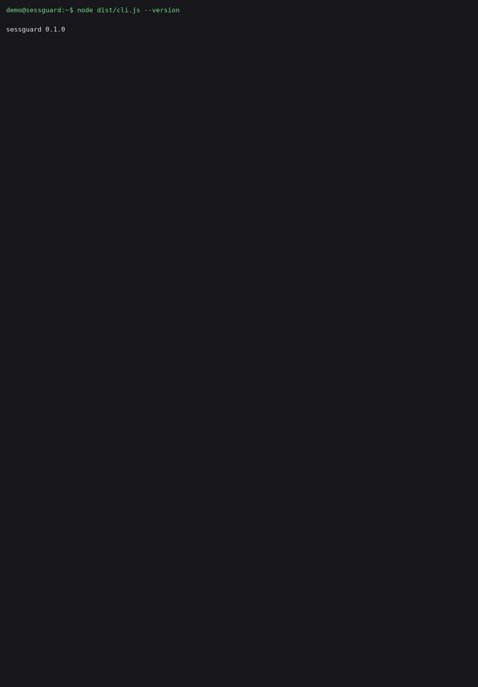

# sessguard

A local, read-only, zero-network CLI that inventories AI-assistant session and credential material on your machine -- and gives you a per-app revocation checklist for incident response. Built for developers who want to know what an infostealer would find on their endpoint. It never prints, logs, or exports token values: findings carry paths, file metadata, and pattern-match counts only.

**What it is NOT:** sessguard does **not** prevent infostealer infection and does **not** detect exfiltration. It is a hygiene and incident-response checklist tool -- it answers "what AI session material lives on this machine and how do I revoke each one", nothing more. Absence of findings is not evidence that a machine is clean.

## Why

Modern infostealers (e.g. the Aokigahara campaign reported by Check Point Research in October 2026) sweep developer machines for authentication files, session data, and configs of AI coding assistants -- Claude, ChatGPT Desktop, Codex, Cursor, Windsurf, GitHub Copilot, Gemini CLI, and others -- alongside Git credentials, SSH keys, and API keys.

Secret scanners like TruffleHog own the *repository* surface; OSQuery can answer endpoint questions only with hand-written queries per app. Nobody maps **"AI session material on THIS machine" -> "here is exactly how to revoke each one"**. That gap is what sessguard fills: curated, dated path knowledge for 10 AI assistants, strict no-value reporting, and an actionable per-app revocation checklist.

**Dual-use note:** the path list is public knowledge (documented by the vendors and by threat research). sessguard extracts no values and makes no network calls, so it cannot be used as an exfiltration aid.

## Install

Requires Node.js 20+.

```sh
npm install -g sessguard
# or run without installing
npx sessguard inventory
```

## Usage

```sh
sessguard inventory [--json out.json]   # scan well-known session/config paths
sessguard checklist [--json out.json]   # per-app revocation checklist
sessguard --version
```

`SESSGUARD_ROOT` overrides the scan root (used by the demo and tests).

Example -- real run against the synthetic demo profile (`examples/demo-profile/`, all fixtures fake):

```sh
$ SESSGUARD_ROOT=examples/demo-profile node dist/cli.js inventory
AI SESSION STORES ON THIS MACHINE
Token values are never shown -- paths, file metadata, and match counts only.

Apps with stores found: 6/10

- Claude Code / Claude CLI:
    stores: .claude.json, .claude
    files: 2, total size: 634 bytes
    newest: today, oldest: today
    files matching token patterns: 1 (6 matches -- values hidden)
- ChatGPT Desktop: not found
- Codex CLI:
    stores: .codex/auth.json, .codex
    files: 2, total size: 378 bytes
    newest: today, oldest: today
    files matching token patterns: 1 (6 matches -- values hidden)
- Cursor:
    stores: .cursor
    files: 1, total size: 231 bytes
    newest: today, oldest: today
    files matching token patterns: 1 (2 matches -- values hidden)
...

$ SESSGUARD_ROOT=examples/demo-profile node dist/cli.js checklist | head -12
REVOCATION CHECKLIST
For each app with session material found on this machine.

## Claude Code / Claude CLI
Stores: .claude.json, .claude
Typically holds: API keys, OAuth session tokens, project session transcripts
Revoke: https://console.anthropic.com/settings/keys
How: Revoke API keys at the console. For OAuth sessions, sign out inside the app as well.
Also rotate: Any API keys you used with Claude Code
...
```

The `--json` manifests carry the same data in machine-readable form -- still no values.

## Demo

Terminal recording of a real run against the synthetic demo profile (`examples/demo-profile/`, all fixtures fake). Recorded on the build machine via pty capture -- no line was invented or reworded:



## Coverage

Curated, dated paths -- apps move their storage locations, so each entry carries the date it was last curated. Verified dates are refreshed with each release.

| App | Last verified |
|---|---|
| Claude Code / Claude CLI | 2026-10-30 |
| ChatGPT Desktop | 2026-10-30 |
| Codex CLI | 2026-10-30 |
| Cursor | 2026-10-30 |
| Windsurf | 2026-10-30 |
| GitHub Copilot (IDE + CLI) | 2026-10-30 |
| Gemini CLI | 2026-10-30 |
| Amazon Q | 2026-10-30 |
| Kiro | 2026-10-30 |
| JetBrains AI Assistant | 2026-10-30 |

## Design

- **TypeScript, zero runtime dependencies**, Node.js 20+.
- **Read-only:** the scanner never writes, follows no symlinks, and reads at most 2 MB per file.
- **Zero network:** no HTTP imports, no `fetch`, no sockets. CI runs the full suite with outbound networking blocked (iptables REJECT isolation on the runner) and a static test asserts no networking API exists in `src/`.
- **No values, ever:** `countTokenPatterns` returns a number only; findings carry paths, sizes, mtimes, and counts. The redaction self-test (`npm run selftest`, also in CI) plants fake secrets in the demo profile and fails the build if any of them reaches the JSON output.

## Development

```sh
npm ci
npm test            # full suite (node:test via tsx)
npm run build       # compile to dist/
npx tsc --noEmit    # strict typecheck
npm run selftest    # redaction self-test against the demo profile
```

## License

MIT -- see [LICENSE](LICENSE).
